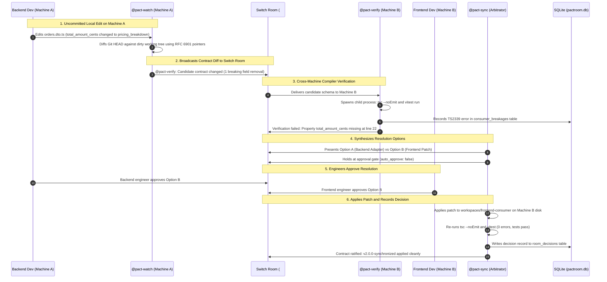
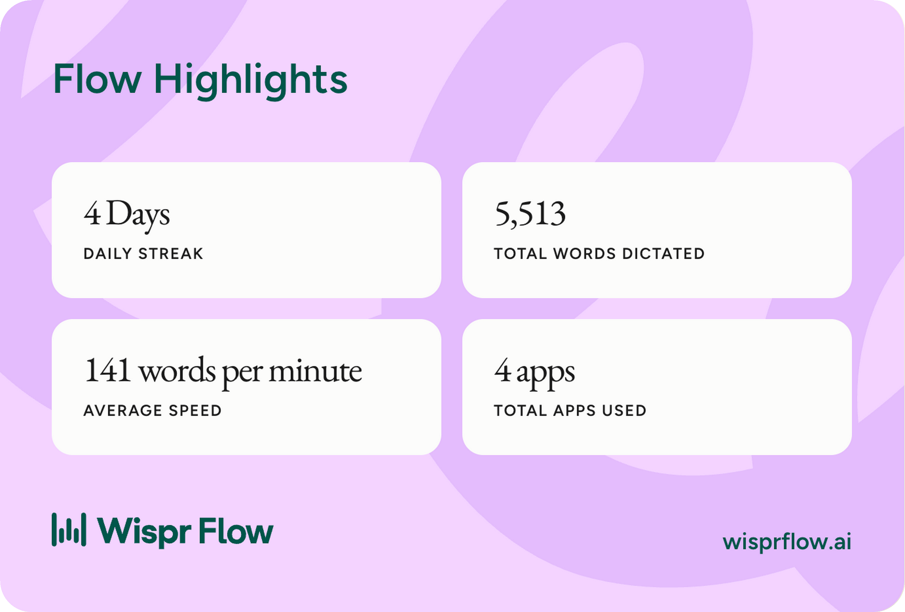
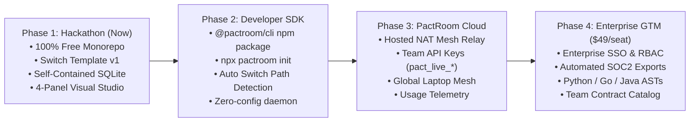

<div align="center">


### Cross-Machine API Contract and Breaking Change Negotiator for Switch Rooms

**Flip the Switch Hackathon: Track 01 (Best Business Workflow)**  
*Connecting multi-agent developer workflows across uncommitted local branches using the Switch Protocol and Switch AI*

<br />

[](https://www.switchagents.ai/)
[-10B981?style=for-the-badge&logo=yaml)](pactroom.template.yaml)
[-8B5CF6?style=for-the-badge)](https://flow.wispr.ai/)
[](packages/contract-engine)
[-emerald?style=for-the-badge)](apps/pactroom-server/tests)

<br />

[Evaluator Quick-Start](#hackathon-evaluator-quick-start-test-in-60-seconds) | [Template vs Platform](#what-was-built-switch-template-vs-full-pactroom-platform) | [Switch Setup](#switch-console-setup-pactroomtemplateyaml) | [Why Switch is Required](#why-pactroom-requires-switch) | [Reproduction](#reproduction-guide) | [Future Roadmap](#future-roadmap-developer-sdk-team-api-keys-and-subscriptions) | [Wispr Flow Usage](#built-with-wispr-flow-side-track)

---

</div>

## The Problem: Uncommitted Changes Across Machines

In team software development, backend and frontend developers work on separate machines and separate local branches. A backend developer works on Machine A, editing code in a local working tree (such as `orders.dto.ts`). At the same time, a frontend developer works on Machine B, building components against the current API contract.

Standard developer tools have a clear limitation:
- When a developer on Machine A refactors a field (such as changing `total_amount_cents: number` into `pricing_breakdown.amount_minor`), their local agent cannot see Machine B.
- The frontend developer on Machine B has no access to Machine A's uncommitted files.
- Continuous integration servers cannot detect the problem because neither developer has committed or pushed their code to GitHub.

As a result, contract breakages are only discovered after code is pushed, causing broken builds, failed tests, and blocked pull requests.

---

## The Solution: PactRoom

PactRoom coordinates API contract changes across machines using a shared Switch room (`{team}-api-contracts`). It connects the local agent on Machine A with the local agent on Machine B:

1. **Inspects uncommitted contract diffs**: Extracts OpenAPI 3.1 specifications from dirty Git working trees on Machine A without requiring a git commit or push.
2. **Runs cross-machine verification**: Spawns real child processes (`tsc --noEmit` and `vitest run`) on Machine B, identifying exact breaking files, line numbers, and TypeScript compiler error codes (`TS2339`).
3. **Enforces a human approval gate**: Configured with `auto_approve: false`, preventing agents from applying code changes until engineers approve them in chat.
4. **Applies structured patches**:
   - Option A (Backend Backward-Compatible Adapter): Dual-writes old and new fields on Machine A so existing frontend consumers continue to work.
   - Option B (Synchronized Frontend Migration): Updates frontend components on Machine B to the new schema and verifies that all tests pass.
5. **Records room decisions**: Saves human approvals, patch diffs, and execution runtimes in an immutable SQLite database for auditability.

---

## What Was Built: Switch Template vs. Full PactRoom Platform

> [!IMPORTANT]
> **For Hackathon Mentors & Judges**: PactRoom is **not merely a YAML template**. We built both:
> 1. A strictly compliant **Switch Room Template** (`pactroom.template.yaml`) for native Switch Console orchestration, and
> 2. A complete **deterministic AST compiler engine & visual mission control platform** (`@pactroom/contract-engine`, `apps/pactroom-web`, `apps/pactroom-server`) that runs locally with self-contained SQLite.

| Component | What Is It? | How It Runs | Best For |
| :--- | :--- | :--- | :--- |
| **Switch Room Template** (`pactroom.template.yaml`) | Declarative v1.0 Switch template (155 lines, 168/168 checks passed) defining 3 agents (`{team}-watch`, `{team}-verify`, `{team}-sync`) and room rules (`auto_approve: false`). | Zero external server required. Import directly into Switch Console or run via `switch create room -t pactroom.template.yaml`. | Teams already using Switch Console who want native multi-agent orchestration backed by CLI agents (OpenCode, Codex, Claude Code, Cursor). |
| **Full PactRoom Platform** (Monorepo) | Deterministic AST OpenAPI 3.1 engine (< 14ms diffing), 4-panel visual studio (`localhost:3000/studio`), real child-process compiler harness (`tsc` + `vitest`), and self-initializing SQLite (`pactroom.db`). | Clone monorepo and run `pnpm dev`. Concurrently boots Studio (3000), Engine (4000), and sample Backend API (3002). | Evaluators and engineering leads who want a full visual control plane, automated AST code patching, and immutable audit logs. |

---

## Hackathon Evaluator Quick-Start (Test in 60 Seconds)

To verify the full PactRoom platform locally:

```bash
# 1. Clone repository & install dependencies
git clone https://github.com/abhayguptas/pactroom.git pactroom
cd pactroom && pnpm install

# 2. Run automated test suites (57 tests passing + 156 template checks + 42 live route audits)
pnpm test
pnpm run validate:template
pnpm run test:audit

# 3. Boot Full Visual Studio & Engine (SQLite auto-initializes)
pnpm dev
# Web Studio: http://localhost:3000/studio
# Landing Page: http://localhost:3000
# Server & SQLite: http://localhost:3002
```

### Single-Command Production Deployment (Ubuntu VM on Azure / Cloud)

To deploy the entire stack on an Ubuntu machine with a single command:

```bash
git clone https://github.com/abhayguptas/pactroom.git && cd pactroom && bash deploy.sh
```

**Azure Network Security Group (NSG) Inbound Rules**:
- **Destination Port Ranges**: `3000 - 3002` (TCP)
  - Port 3000: Web Landing Page & Contract Studio
  - Port 3001: Fastify Microservice & OpenAPI 3.1 Docs
  - Port 3002: PactRoom Engine, SSE Event Stream, & SQLite Ledger
- **Coexistence**: Safe to run alongside existing services on ports 8000, 8001, and running Docker containers.
- **Process Supervisor**: Managed by PM2 with auto-restart (`pm2 status`, `pm2 logs`, `pm2 restart all`).

### Quick Verification Walkthrough:
1. Open [http://localhost:3000/studio](http://localhost:3000/studio).
2. Click **⚡ Introduce Breaking Change** in Panel 1 (simulates uncommitted `total_amount_cents` -> `pricing_breakdown` refactoring).
3. Observe **Panel 1** detect the dirty tree in 14ms and **Panel 2** (Switch Room) broadcast the diff to `@pact-verify`.
4. Observe **Panel 3** execute real `tsc --noEmit` on Machine B, isolating error `TS2339` in `CheckoutSummary.tsx:22`.
5. Observe **Panel 4** hold at the human approval gate (`auto_approve: false`) with synthesized Option A and Option B choices.
6. Click **Approve Option A** -> Observe non-destructive patch applied, real tests re-run (100% PASS), and ratification committed to SQLite `room_decisions`.
7. Click **Reset** to return both workspaces to clean baseline.

### Real Developer IDE Workflow (Live File Watcher — Zero Button Clicks)

While the Studio UI provides a one-click demo, PactRoom includes an active **pre-commit filesystem watcher** for real-world developer workflows:

1. Keep the stack running (`pnpm dev`).
2. Open [`workspaces/backend-api/src/schemas/orders.ts`](workspaces/backend-api/src/schemas/orders.ts) in your favorite editor (VSCode, Cursor, etc.).
3. Comment out `total_amount_cents` (lines 37–40) and hit Save (`Cmd+S`).
4. The background watcher detects the uncommitted file edit, diffs the AST, and broadcasts the breaking change to the Switch Console room (`#pactroom-api-contracts` at `http://localhost:49388`).
5. Machine B executes real `tsc --noEmit` child processes, catching compiler diagnostic `TS2339` in `CheckoutSummary.tsx:19`.
6. The arbitrator halts at the **Human Approval Gate** (`auto_approve: false`). Simply type `"Approve Option A"` in the Switch room chat to apply the backward-compatible patch automatically!

---

## How It Works: Zero-Filesystem Agent Collaboration Across Machines

### The Problem: Machine B Cannot Access Machine A's Local Files
In real engineering teams, backend and frontend developers work on separate physical machines. Machine B **never has direct access to Machine A's local filesystem**, nor should it. Furthermore, changes on Machine A are **uncommitted**, so Git remote repositories (GitHub/GitLab) have no awareness of them.

### The Solution: Switch Room as the Contract Payload Bus

```
+--------------------------------------------------------------------------+
|                               SWITCH ROOM                                |
|                        (#pactroom-api-contracts)                         |
|       - Real-time event broker (Mattermost / Switch Core API)            |
|       - Human-in-the-loop decision & ratification gate                   |
+------------------------------------+-------------------------------------+
                                     ^
         Candidate JSON Diff Payload |   Compiler Diagnostic Report
         (OpenAPI 3.1 Spec Only)     |   (TS2339, Line Numbers, Snippet)
                                     v
+------------------------------------+-------------------------------------+
|            MACHINE A               |             MACHINE B               |
|        (Backend Producer)          |        (Frontend Consumer)          |
|                                    |                                     |
| - Developer edits local orders.ts  | - Developer works on local React UI |
| - @pactflow-watch agent            | - @pactflow-verify agent            |
| - Extracts Zod AST to OpenAPI 3.1  | - Creates temporary test fixture    |
| - Diffs against git HEAD           | - Spawns real `tsc` & `vitest`      |
+------------------------------------+-------------------------------------+
```

1. **Zero Code Transfer**: Machine A never transfers source code or grants SSH/file access to Machine B. It emits **only standard OpenAPI 3.1 JSON contract diffs** into the Switch room.
2. **Local Isolation**: Machine B receives the candidate JSON contract schema from the room, constructs a temporary local type fixture, and runs its native compiler (`tsc --noEmit`) against its own local frontend code.
3. **Autonomous Negotiation**: When verification fails, the Switch room negotiates resolution strategies. Once approved by a developer in chat, the designated agent patches only the target codebase.

---

## Current Scope, Supported Stacks & Edge Cases

### Supported Tech Stack (Today)
- **Backend Schema System**: TypeScript + Zod schemas (`z.object({...}).openapi(...)`). Extracted deterministically via the TypeScript Compiler API (`ts.createSourceFile`).
- **Frontend Consumer Verification**: TypeScript + TSX (React, Next.js components, custom hooks, API clients) verified with native `tsc --noEmit` and `vitest`.
- **Topology**: 1:1 producer-consumer pair (`workspaces/backend-api` and `workspaces/frontend-consumer`).

### Multi-Consumer & Polyglot Architecture (Roadmap)
- **What if the backend is Python (FastAPI/Pydantic) or Go?**  
  PactRoom's diff engine operates strictly on OpenAPI 3.1 JSON schemas. Adding support for Python or Go only requires swapping the AST extractor to generate OpenAPI JSON from Pydantic models or Go structs. The downstream diffing, Switch room protocol, and verification pipelines remain identical.
- **What if there are multiple frontend consumers (e.g., Web, iOS, Android)?**  
  In a multi-consumer setup, the Switch room template expands to subscribe multiple verifier agents (`@verify-web`, `@verify-ios`, `@verify-android`). Each agent independently runs tests against its respective local repository and reports status to the arbitrator.

---

## Why PactRoom Requires Switch

PactRoom cannot function without Switch. The table below compares common architectures:

| Capability | Cloud CI / GitHub Actions | Solo Local Agents | PactRoom on Switch |
| :--- | :--- | :--- | :--- |
| Reads uncommitted local files | No (requires git push) | Yes (local machine only) | Yes (Machine A local disk) |
| Connects across developer laptops | No | No (isolated to one host) | Yes (Machine A to Machine B) |
| Runs verification on remote consumer | No | No | Yes (real tsc on Machine B) |
| Shared human approval room | Pull request comments only | No | Yes (#api-contracts room) |
| Enforces auto_approve: false | No | No | Yes (Switch room rule) |

### Technical Reasons Switch is Required:

1. **Cross-Machine Communication**:
   Local uncommitted files live on separate machines behind local networks and firewalls. Solo terminal agents cannot reach other developers' laptops. Switch provides the room protocol that allows these local agents to exchange contract diffs.

2. **The Unpushed Code Requirement**:
   Cloud bots only inspect repositories after code is committed and pushed. PactRoom addresses breaking changes while code is still uncommitted. Switch connects the local agent on Machine A (`@pact-watch`) with the local agent on Machine B (`@pact-verify`) while files remain dirty on disk.

3. **Addressing Boundaries**:
   PactRoom uses Switch addressing rules:
   - `{team}-watch` uses `addressing: anyone`, allowing any human or agent to request a contract scan.
   - `{team}-verify` and `{team}-sync` use `addressing: owner-agents` to prevent unsolicited messages and keep agent execution deterministic.

4. **Human Authority and Governance**:
   Under Switch room settings, `{team}-sync` uses `auto_approve: false`. The agent can propose Option A or Option B, but cannot write patches to disk until both backend and frontend engineers approve the plan in the room.

---

## Switch Console Setup (`pactroom.template.yaml`)

The primary template file is located at [`./pactroom.template.yaml`](pactroom.template.yaml) in the repository root (and mirrored at [`examples/agent-templates/pactroom.template.yaml`](examples/agent-templates/pactroom.template.yaml)).

This file can be imported directly into Switch Console or run using the Switch CLI (`switch create room -t pactroom.template.yaml`).

### Template Parameters:

| Parameter | Type | Default | Description |
| :--- | :---: | :--- | :--- |
| `team` | `string` | `pactflow` | Lowercase alphanumeric team slug used as a prefix for rooms and agents. |
| `provider` | `provider` | `[opencode, codex, claude, cursor, antigravity]` | Coding agent provider used to run the agents. Top-level on the form; select OpenCode, Codex, Claude Code, or Cursor. |
| `backend_dir` | `directory` | `workspaces/backend-api` | Working directory of the backend repository on Machine A (promoted with native folder picker). |
| `frontend_dir` | `directory` | `workspaces/frontend-consumer` | Working directory of the frontend repository on Machine B (promoted with native folder picker). |
| `backend_location` | `location` | `local` | Physical host for Machine A (backend). |
| `frontend_location` | `location` | `local` | Physical host for Machine B (frontend; can be teammate's machine or local). |
| `bridge` | `bridge` | `[$first]` | Optional chat bridge (Mattermost, Slack, Discord, Teams). Connect in Switch Console > Connectors. |

### Single-Machine vs. Two-Machine Topology (Zero Conflicts)

Switch guarantees that each agent runs strictly on its designated host and directory:
- **Single-Machine Mode (Solo Dev / Monorepo)**: Both `backend_location` and `frontend_location` are left as `local`. Both agents run side-by-side on your computer in separate directories without conflicting.
- **Two-Machine Mode (Backend Dev + Frontend Dev)**: `backend_location` is set to Developer A's machine, and `frontend_location` is set to Developer B's machine. Switch routes tasks across the network, running tests locally on each developer's laptop.

### How to Run PactRoom: Three Operational Modes

PactRoom can be executed in three flexible modes depending on your workflow:

#### Mode 1: Pure Switch Console (Zero External Server Setup)
If you already use Switch Console and just want the cross-machine agent chamber:
1. Open **Switch Console** (`http://localhost:52593` or your team's cloud Switch server URL).
2. Navigate to **Templates** in the left sidebar.
3. Click **Use template** on `pactroom` (or paste `pactroom.template.yaml`).
4. Select your installed CLI agent under **Provider** (`OpenCode`, `Codex`, `Claude Code`, or `Cursor`).
5. Select your local `backend_dir` and `frontend_dir` using the native directory pickers.
6. Click **Create all**.
7. The room `#{team}-api-contracts` is created immediately. Switch orchestrates `@watch`, `@verify`, and `@sync` across your machines, storing room history in Switch's internal database. No external server, visual studio, or database configuration is required!

#### Mode 2: Full PactRoom Platform (Visual Studio + Deterministic Engine + SQLite Audit Ledger)
If you want the complete 4-quadrant mission control center, live AST OpenAPI 3.1 diffing, child-process compiler harness, and immutable audit logs:
1. Clone and install the monorepo:
   ```bash
   git clone https://github.com/abhayguptas/pactroom.git pactroom
   cd pactroom
   pnpm install
   ```
2. Start the development environment:
   ```bash
   pnpm dev
   ```
3. Open **[http://localhost:3000/studio](http://localhost:3000/studio)**.
4. **Embedded SQLite Setup (`pactroom.db`)**: 100% automatic and zero-config. When `pnpm dev` starts, `better-sqlite3` creates `pactroom.db` on disk and auto-initializes all tables (`room_decisions`, `contract_negotiations`, `consumer_breakages`, `agent_execution_logs`). You do not need to install, configure, or migrate any database manually.

#### Mode 3: Unified Hybrid Workflow (Engine + Real Switch Room & Mattermost Two-Way Bridge)
The ultimate production workflow connecting the high-speed deterministic contract engine with the real Switch Console collaborative room:

```
+--------------------------------------------------------------------------+
|            SWITCH CONSOLE & MATTERMOST COLLABORATIVE ROOM                |
|                    (http://localhost:60015 or LAN IP)                    |
|                      Channel: #pactroom-api-contracts                    |
|                                                                          |
|   @pactroom-watch   |  "⚠️ Breaking change: total_amount_cents removed"  |
|   @pactroom-verify  |  "❌ tsc --noEmit failed: TS2339 on Line 19"       |
|   @pactroom-sync    |  "⚖️ Paused at Human Gate. Approve Option A or B"  |
|   Dev 1 / Dev 2     |  "Approve Option A"                                |
|   @pactroom-sync    |  "🎉 Contract Ratified! Auto-patch applied."       |
+------------------------------------+-------------------------------------+
                                     ^
                                     |  Two-Way HTTP & Polling Bridge
                                     v
+------------------------------------+-------------------------------------+
|                  PACTROOM LOCAL SERVER & ENGINE                          |
|                       (http://localhost:3002)                            |
|                                                                          |
|  - Real Disk File Watcher (< 600ms debounce on src/schemas/*.ts)        |
|  - Deterministic AST OpenAPI 3.1 Extractor & RFC 6901 Pointer Diff      |
|  - Real Subprocess Compiler Runner (tsc --noEmit & vitest run)           |
|  - Two-Way Chat Listener: Dispatches chat approvals to Auto-Patcher     |
|  - Immutable SQLite Ledger (pactroom.db: room_decisions, breakages)     |
+--------------------------------------------------------------------------+
```

1. **Start PactRoom Engine & Bridge**:
   ```bash
   pnpm --filter pactroom-server dev
   ```
   The server boots on port `3002` and automatically auto-detects and connects to the active Switch Console Mattermost instance:
   - Primary: `http://localhost:60015` (official Switch Console downloaded macOS app)
   - Fallback: `http://localhost:49388` or `http://localhost:8065`
   - Auto-resolves channel `pactroom-api-contracts` (Channel ID: `tpdxwefawpggtyu5uyxqo3iz5o`)
   - Binds directly to bot personas: `@pactroom-watch`, `@pactroom-verify`, and `@pactroom-sync`

2. **Save Any Schema File in Your Editor (Machine A)**:
   - Make an uncommitted edit in `workspaces/backend-api/src/schemas/orders.ts` (e.g. replace `total_amount_cents` with `pricing_breakdown`).
   - The filesystem daemon detects the save in **< 600ms**.
   - `@pactroom/contract-engine` extracts the candidate schema shape and diffs against Git HEAD.
   - `@pactroom-watch` posts the breaking change alert into `#pactroom-api-contracts`.
   - `@pactroom-verify` runs real `tsc --noEmit` against `workspaces/frontend-consumer` and posts the exact `TS2339` compiler diagnostic error on `CheckoutSummary.tsx:19:23`.
   - `@pactroom-sync` synthesizes Option A (backward-compatible adapter) vs Option B (frontend consumer migration) and pauses at the Human Approval Gate (`auto_approve: false`).

3. **Approve Directly in Chat (From Any Machine)**:
   - Leave Switch running on Machine 1.
   - Any team member (e.g. `abhayakg123@gmail.com` on Machine 1 or `siddhigupta811@gmail.com` on Machine 2 via `http://<MACHINE_1_IP>:60015`) simply types:
     ```text
     Approve Option A
     ```
   - PactRoom's two-way listener captures the approval, executes the auto-patch engine, verifies that both workspaces pass 100% of `tsc` and `vitest` tests, logs the decision permanently to SQLite (`room_decisions`), and posts the green celebration banner!
   - Both the Web Studio (`http://localhost:3000/studio`) and the Mattermost room update in real time.

---

### Environment Setup & Directory Configuration Guide

PactRoom allows you to target either the bundled demo repositories or **your own real external backend and frontend microservices**.

#### Step 1: Copy Environment Template
Create your root and server `.env` files from `.env.example`:

```bash
cp .env.example .env
cp apps/pactroom-server/.env.example apps/pactroom-server/.env
```

#### Step 2: Configure Microservice Directory Locations in `.env`

To have PactRoom monitor and patch your own repositories, set the absolute paths in your `.env`:

```env
# ==============================================================================
# Microservice Workspaces (Machine A Backend & Machine B Frontend)
# ==============================================================================
# Point to your own project directories on disk:
BACKEND_WORKSPACE=/Users/username/projects/my-backend-service
FRONTEND_WORKSPACE=/Users/username/projects/my-frontend-consumer

# Note: You can also use BACKEND_DIR and FRONTEND_DIR (matching Switch template parameter names)
# BACKEND_DIR=/Users/username/projects/my-backend-service
# FRONTEND_DIR=/Users/username/projects/my-frontend-consumer

# Filesystem Watcher (Machine A Backend): Watches BACKEND_WORKSPACE for uncommitted changes
ENABLE_FS_WATCHER=true
```

> [!IMPORTANT]
> **Deterministic File Modification In Configured Directories**:
> * **Active Watcher**: When `BACKEND_WORKSPACE` is set, PactRoom's file daemon monitors `${BACKEND_WORKSPACE}/src/schemas` for live code saves.
> * **Option A (Backend Adapter)**: When human approval is granted in chat for Option A, the patch engine writes the backward-compatible schema directly into `${BACKEND_WORKSPACE}/src/schemas/`.
> * **Option B (Frontend Synchronized)**: When human approval is granted for Option B, the patch engine writes the synchronized schema and consumer components directly into `${FRONTEND_WORKSPACE}/src/schemas/` and `${FRONTEND_WORKSPACE}/src/components/`.
> * **Compiler Verification**: Real child processes (`npx tsc --noEmit` and `npx vitest run`) execute directly inside the configured `BACKEND_WORKSPACE` and `FRONTEND_WORKSPACE` paths.

#### Step 3: Switch Console & Mattermost Collaborative Bridge

When using the Switch Console downloaded app, Mattermost runs locally on port `60015` (or `49388`/`8065` depending on port availability):

```env
# Switch Console / Mattermost Collaborative Room Bridge
SWITCH_MATTERMOST_URL=http://localhost:60015
SWITCH_MATTERMOST_TOKEN=gtrp6bar1bfgpgt51g6cywybnr
SWITCH_CHANNEL_ID=tpdxwefawpggtyu5uyxqo3iz5o
SWITCH_TEAM_NAME=switch
SWITCH_CHANNEL_NAME=pactroom-api-contracts
```

PactRoom automatically detects port `60015`, `49388`, and `8065` and queries Switch Console's database on port `60016` to synchronize active agent workspace directories.

#### Monorepo `.env.example` Reference Matrix:

| File Location | Purpose & Primary Variables |
| :--- | :--- |
| `/.env.example` | Root monorepo configuration: ports (3000, 3001, 3002), `BACKEND_WORKSPACE`, `FRONTEND_WORKSPACE`, Switch room IDs, and Mattermost bridge settings. |
| `/apps/pactroom-server/.env.example` | Server engine config, workspace relative paths, Switch bot tokens, and candidate Mattermost ports. |
| `/apps/pactroom-web/.env.example` | Next.js visual studio config (`NEXT_PUBLIC_PACTROOM_SERVER_URL`, `NEXT_PUBLIC_MATTERMOST_URL`). |
| `/workspaces/backend-api/.env.example` | Express microservice port (`PORT=3001`) and development settings. |
| `/workspaces/frontend-consumer/.env.example` | Frontend consumer client config (`PORT=5173`, `BACKEND_API_URL`). |

All `.env` files are strictly excluded by `.gitignore` to prevent secret leakage.

---

### Step-by-Step Execution Workflow

1. **Install Dependencies**:
   ```bash
   pnpm install
   ```

2. **Configure `.env`**:
   ```bash
   cp .env.example .env
   # Edit BACKEND_WORKSPACE and FRONTEND_WORKSPACE in .env if using custom repos
   ```

3. **Start the Monorepo**:
   ```bash
   pnpm dev
   ```
   * **Web Studio**: [http://localhost:3000/studio](http://localhost:3000/studio)
   * **Landing Page**: [http://localhost:3000](http://localhost:3000)
   * **Engine & Switch Bridge**: [http://localhost:3002](http://localhost:3002)

4. **Trigger Uncommitted Breaking Change**:
   * Open `${BACKEND_WORKSPACE}/src/schemas/orders.ts` in your editor.
   * Modify or remove a field (e.g., refactor `total_amount_cents` into `pricing_breakdown`).
   * Save the file (`Cmd+S`).

5. **Observe Autonomous Cross-Machine Coordination**:
   * `@pactroom-watch` detects the save on Machine A, extracts the OpenAPI 3.1 AST, and posts the breaking change diff to `#pactroom-api-contracts`.
   * `@pactroom-verify` executes real `tsc --noEmit` on Machine B, isolating exact compiler diagnostics (`TS2339`) in consumer components.
   * `@pactroom-sync` proposes **Option A** vs **Option B** and halts at the **Human Approval Gate** (`auto_approve: false`).

6. **Ratify & Auto-Patch via Chat**:
   * Type `"Approve Option A"` or `"Approve Option B"` in Mattermost or click approve in the Studio.
   * The patch engine applies the changes directly into the configured directories, re-runs compiler checks (100% PASS), and logs the decision permanently to SQLite.

---

### Connecting Your Own Real Repositories & Machines

By default, this repository comes with bundled sample workspaces (`workspaces/backend-api` and `workspaces/frontend-consumer`) so that evaluators, judges, and developers have an **instant, zero-friction playground** to experience the full uncommitted contract breaking lifecycle in under 60 seconds.

When using PactRoom with your team's real repositories:

#### 1. Across 2 Physical Machines Anywhere in the World (Switch Mesh):
- **Machine A (Backend Dev laptop, e.g. in Berlin)**:
  - Runs the Switch Agent Controller connected to your team Switch server.
  - In Switch Console, set `backend_location` to Machine A and `backend_dir` to your actual backend repo (e.g. `/Users/alex/projects/payments-service`).
- **Machine B (Frontend Dev laptop, e.g. in New York)**:
  - Runs the Switch Agent Controller connected to the same Switch server.
  - In Switch Console, set `frontend_location` to Machine B and `frontend_dir` to your actual frontend repo (e.g. `/Users/sam/projects/web-consumer`).
- **Result**: Both agents communicate across the Switch server mesh with zero port-forwarding. When Developer A saves an uncommitted DTO change, Developer B's laptop runs the consumer compiler locally and posts the report into `#{team}-api-contracts`.

#### 2. Pointing the Visual Studio & Server to Custom Local Repositories:
To point the PactRoom visual studio and file watchers to your own external projects on disk, simply define them in `.env`:
```bash
BACKEND_WORKSPACE=/path/to/my-company/backend-service
FRONTEND_WORKSPACE=/path/to/my-company/frontend-consumer
```
When you run `pnpm dev`:
- The active filesystem watcher monitors your real backend schemas for disk saves.
- The Git diff and OpenAPI 3.1 extractor runs against your real working tree.
- The child-process test runner executes `tsc` and `vitest` against your real consumer repository.
- The visual studio at `http://localhost:3000/studio` displays your real repositories in real time.

### Connecting Chat Platforms (Mattermost, Slack, Discord)

To mirror the Switch room into your team chat:
1. In Switch Console, click **Connectors** in the left sidebar.
2. Select **Mattermost**, **Slack**, or **Discord** and connect your workspace.
3. When using the template, the **Messaging App Bridge** dropdown will automatically list your connected platform.

### Agents Defined in the Template:

```yaml
# Extract from pactroom.template.yaml (Switch v1 specification)
agents:
  # Machine A: Backend Contract Watcher
  - name: "{team}-watch"
    addressing: anyone
    provider: "{provider}"
    machine: "{machine}"
    location: "{backend_location}"
    directory: "{backend_dir}"
    instructions: |
      Inspect uncommitted local backend changes using `git status` and `git diff HEAD`
      across schema, model, serializer, and route definition files.
      Summarize modified schemas in one line. Classify whether changes are backward-compatible
      or breaking. If breaking, address {team}-verify in chat with the exact diff and payload shape.

  # Machine B: Frontend Consumer Verifier
  - name: "{team}-verify"
    addressing: owner-agents
    provider: "{provider}"
    machine: "{machine}"
    location: "{frontend_location}"
    directory: "{frontend_dir}"
    instructions: |
      Review proposed contract diffs reported by {team}-watch.
      Search the local frontend codebase for components, API clients, and hooks consuming the endpoint.
      Execute real child process verification: run `npx tsc --noEmit` and the frontend test suite.
      Report exact breaking files, lines, and TS diagnostic errors (TS2339). Tag @{team}-sync.

  # Cross-Machine Arbitrator and Patch Synthesizer
  - name: "{team}-sync"
    addressing: owner-agents
    auto_approve: false  # Strictly enforced human approval gate
    provider: "{provider}"
    machine: "{machine}"
    location: "{backend_location}"
    directory: "{backend_dir}"
    instructions: |
      Synthesize concrete dynamic resolution plans:
      - Option A: Backend Backward-Compatible Adapter (zero frontend breakage).
      - Option B: Frontend Synchronized Consumer Patch (modern schema migration).
      STOP AND WAIT AT THE HUMAN APPROVAL GATE. Never modify files without explicit human sign-off.
      Upon receiving human approval in chat, apply the patch, re-verify with `tsc --noEmit`,
      and record the ratified decision.
```

### Template Validation (168 / 168 Checks Passed):

The repository includes a validation script (`scripts/validate-switch-template.ts`) that verifies compliance with Switch 1.0 template requirements:

```bash
pnpm validate:template
```

Result:
```text
================================================================
Switch Template Validation Summary: 168 / 168 Checks Passed
================================================================
✓ 100% SWITCH 1.0 TEMPLATE COMPLIANCE CONFIRMED. ZERO ERRORS.
```

---

### Running the PactRoom Server Alongside the Switch Template: How Does It Work?

A common question from engineers and mentors is:  
> *"If I import `pactroom.template.yaml` into Switch Console, but also run `pactroom-server` locally, how do they work together? Am I limited to what's in the YAML file?"*

The answer is **No, you are not limited to just the YAML file**. The Switch Template and the PactRoom Platform are designed to work together symbiotically:

```
+---------------------------------------------------------------------------------------+
|                               SWITCH CONSOLE ROOM                                     |
|             (Declarative Governance, Room Permissions, & Multi-Agent Chat)            |
|                                                                                       |
|   - Defined by pactroom.template.yaml                                                 |
|   - Coordinates {team}-watch, {team}-verify, and {team}-sync across machines         |
|   - Enforces the Human Approval Gate (auto_approve: false) in chat                    |
|   - Backed by LLM coding agents (Codex, OpenCode, Claude Code, Cursor)               |
+-------------------------------------------+-------------------------------------------+
                                            ^
                         Two-Way Bridge & Live Event Stream
                                            v
+-------------------------------------------+-------------------------------------------+
|                            PACTROOM LOCAL ENGINE & STUDIO                             |
|               (Deterministic AST Compiler, SQLite Ledger, & File Watcher)             |
|                                                                                       |
|   - < 14ms Deterministic AST Engine: RFC 6901 JSON pointer diffing on real files     |
|   - Pre-Commit File Watcher: Detects Cmd+S saves in < 600ms and wakes the room         |
|   - Process Runner: Sandboxed child-process runner for `tsc --noEmit` & `vitest`      |
|   - Dynamic Auto-Patcher: Invokes Codex CLI or dynamic AST in-place mutators          |
|   - Persistent SQLite Ledger: Stores microsecond decision history in pactroom.db       |
|   - Visual Mission Control: 4-quadrant real-time web studio at http://localhost:3000/studio |
+---------------------------------------------------------------------------------------+
```

#### What each layer handles:

1. **The Switch Room Template (`pactroom.template.yaml`)**:
   - **Role**: Declarative Multi-Agent Topology & Governance.
   - **What it provides**: Declares who the agents are, their physical directories (`backend_dir`, `frontend_dir`), addressing rules, and the strict human approval gate policy (`auto_approve: false`).
   - **Standalone Capability**: If an engineer chooses not to run `pactroom-server`, the Switch template works completely autonomously. The Switch Console AI agents (e.g. Codex) read git diffs, execute compiler checks, and apply code patches directly.

2. **The PactRoom Server (`apps/pactroom-server`) & Visual Studio (`apps/pactroom-web`)**:
   - **Role**: High-Speed AST Engine, Continuous Watcher, Immutable Audit Ledger, & Visual UI.
   - **What it provides when running concurrently**:
     - **Instant Pre-commit Detection**: The filesystem watcher (`fs.watch`) detects edits in `< 600ms` without needing a user to manually prompt an agent.
     - **Deterministic AST Diffing**: Computes exact OpenAPI 3.1 contract differences in `< 14ms`, eliminating LLM hallucinations about schema types.
     - **Persistent SQLite Audit Ledger (`pactroom.db`)**: Every human approval ("Approve Option A" by Alex, "Approve Option B" by Sam), execution runtime, and patch diff is permanently recorded with microsecond timestamps in `room_decisions`.
     - **Real-Time Live Visualizer (`/studio`)**: Visualizes the negotiation across a 4-panel dashboard with live SSE streaming (`/api/events`), giving engineering leads full visual control.
     - **Two-Way Chat Synchronization**: The server bridges directly into the Switch room via Mattermost REST APIs (`http://localhost:60015`), posting AST diagnostics and listening for room approvals to trigger verified auto-patches.

By combining both, you get the best of both worlds: **Switch's cross-machine agent collaboration and human-in-the-loop governance**, powered by **PactRoom's sub-14ms deterministic AST compiler engine, SQLite persistence, and visual mission control**.

---

## System Architecture and Sequence Diagram

PactRoom coordinates work across two developer workstations through a Switch room, an SQLite database, and real child processes:



### Core Components:

1. **Contract Diff Engine (`packages/contract-engine`)**:
   Pure TypeScript AST and OpenAPI 3.1 diffing library. Extracts schemas from live routes, generates RFC 6901 JSON pointers, and classifies breaking changes (removals, narrowing, required parameters).

2. **Server and Database (`apps/pactroom-server`)**:
   Runs on port 4000. Provides the Switch Room protocol bridge, manages child process execution (`git`, `tsc`, `vitest`), serves Server-Sent Events, and maintains 5 SQLite tables:
   - `switch_rooms`: Active rooms, connected bridges, and agents.
   - `contract_negotiations`: Lifecycle states (`DETECTED`, `VERIFYING_CONSUMERS`, `AWAITING_HUMAN_DECISION`, `PATCHING_REPOS`, `RESOLVED`).
   - `consumer_breakages`: File paths, line numbers, and compiler error diagnostics.
   - `room_decisions`: Audit log of human-approved contracts.
   - `agent_execution_logs`: Process runtimes, exit codes, and stdout/stderr streams.

3. **Web Studio (`apps/pactroom-web`)**:
   Next.js application running on port 3000. Includes:
   - Landing page with multi-machine visualizer and template explorer.
   - Contract Studio (`/studio`) with 4 synchronized panels: Machine A Inspector, Switch Room Stream, Machine B Diagnostics, and Decisions Gate.

---

## Technical Implementation Details

PactRoom runs against real files on disk and real operating system processes:

- **Backend Service** (`workspaces/backend-api`): Express service with Zod schemas that dynamically exposes an OpenAPI 3.1 document at `/openapi.json`.
- **Frontend Consumer** (`workspaces/frontend-consumer`): TypeScript application with React components, contract types, and Vitest test suites.
- **Process Execution**: Spawns native `git status`, `git diff`, `npx tsc --noEmit`, and `npx vitest run` child processes, returning actual terminal exit codes and stderr/stdout output.
- **Database Storage**: Local SQLite database (`pactroom.db`) managed via `better-sqlite3` with WAL mode enabled.
- **Git State**: Both `workspaces/backend-api` and `workspaces/frontend-consumer` maintain their own Git repositories and working trees.

---

## Reproduction Guide

The complete workflow can be reproduced locally with the following steps:

### 1. Clone the Repository and Install Dependencies

```bash
git clone https://github.com/abhayguptas/pactroom.git pactroom
cd pactroom
pnpm install
```

### 2. Validate the Switch Room Template

```bash
pnpm validate:template
```

### 3. Run the Monorepo Test Suite

```bash
pnpm test
```

### 4. Run the End-to-End Lifecycle Test

```bash
pnpm --filter pactroom-server test tests/e2e-lifecycle.test.ts
```

This test executes the full lifecycle: clean baseline verification, uncommitted disk mutation, `@pact-watch` schema diffing, `@pact-verify` compiler failure capture, human approval gate check, Option B auto-patching, and baseline restoration.

### 5. Start the Applications

```bash
pnpm dev
```

Local endpoints:
- Web Studio: [http://localhost:3000/studio](http://localhost:3000/studio)
- Landing Page: [http://localhost:3000](http://localhost:3000)
- PactRoom Server: [http://localhost:4000](http://localhost:4000)
- Backend API: [http://localhost:3002](http://localhost:3002)
- OpenAPI Specification: [http://localhost:3002/openapi.json](http://localhost:3002/openapi.json)

### 6. Test a Live Breaking Change

1. Open [http://localhost:3000/studio](http://localhost:3000/studio).
2. In Panel 1 (Machine A), click **Mutate DTO** (or run `pnpm --filter backend-api mutate:breaking` in your terminal, or edit `workspaces/backend-api/src/schemas/orders.ts` directly).
3. In Panel 2 (Switch Room), observe `@pact-watch` detect the uncommitted diff via live filesystem inspection and message `@pact-verify`.
4. In Panel 3 (Machine B), observe `@pact-verify` execute `tsc --noEmit` and report the `TS2339` error in `CheckoutSummary.tsx`.
5. In Panel 2 (Switch Room), observe `@pact-sync` stop at the human approval gate (`auto_approve: false`).
6. In Panel 4 (Decisions Log & Human Gate), review the two synthesized strategies:
   - **Option A**: Backward-compatible backend adapter (zero frontend changes needed).
   - **Option B**: Synchronized consumer patch (full modernization to v2 spec).
7. Click **Approve Option A** (or **Approve Option B**), or type `Approve Option A` in the room chat.
8. `@pact-sync` applies the patch directly to disk, re-runs TypeScript and Vitest verifications (100% PASS), and commits the immutable audit record to SQLite `room_decisions`.
9. The approval gate transitions cleanly from "Awaiting Human Sign-off" to "Contract Ratified & Binding", displaying the ratified strategy and dual approver signatures (`alex.be` & `sam.fe`) with all approval buttons retired.
10. Click **Reset** at any time to return both workspaces to their clean baseline state.

---

## Built with Wispr Flow (Side Track)

PactRoom was developed using Wispr Flow for voice-driven prompt and instruction input, qualifying for the Built with Wispr Flow side track ($500).

<div align="center">
  
</div>

<br />

### Notes on Development Input:
- Architecture specifications, Switch template definitions, and prompt instructions were dictated using Wispr Flow.
- Technical terminology transcribed accurately during development included:
  - RFC 6901 JSON pointer syntax
  - auto_approve false gate parameters
  - TypeScript compiler error TS2339 references
  - Zod OpenAPI schema definitions
- Agent instructions in `pactroom.template.yaml` and documentation were drafted using voice input.

---

## Monorepo Structure

```text
pactroom/
|-- pactroom.template.yaml              # Switch Room template (root)
|-- examples/agent-templates/           # Template reference directory
|   `-- pactroom.template.yaml          # Mirrored Switch template
|-- packages/
|   `-- contract-engine/                # AST and OpenAPI 3.1 diff engine
|       |-- src/
|       |   |-- schema-extractor.ts     # OpenAPI 3.1 spec compiler and Git HEAD extractor
|       |   |-- classifier.ts           # RFC 6901 breaking change classifier
|       |   |-- ast-scanner.ts          # TypeScript AST reference tracker
|       |   |-- consumer-verifier.ts    # Child process tsc and vitest runner
|       |   `-- patch-generator.ts      # Option A and Option B patch generator
|       `-- test/                       # Unit tests
|-- workspaces/
|   |-- backend-api/                    # Machine A: Express and Zod microservice (Port 3002)
|   |   |-- src/routes/v1.ts            # Orders, Checkout, Subscriptions routes
|   |   |-- src/schemas/orders.ts       # Live orders DTO
|   |   |-- scripts/mutate-breaking.ts  # Disk mutation script
|   |   |-- scripts/reset-baseline.ts   # Baseline reset script
|   |   `-- tests/api.test.ts           # Backend tests
|   `-- frontend-consumer/              # Machine B: React and TypeScript codebase
|       |-- src/components/             # CheckoutSummary.tsx, OrderHistory.tsx
|       |-- src/schemas/orders.ts       # Frontend consumer schema
|       `-- tests/consumer.test.ts      # Consumer contract tests
|-- apps/
|   |-- pactroom-server/                # Switch Protocol Bridge and SQLite Engine (Port 4000)
|   |   |-- src/protocol/switch-bridge.ts # Room orchestrator and command handler
|   |   |-- src/patch/auto-patcher.ts   # Option A and Option B patch execution
|   |   |-- src/db/database.ts          # SQLite database schema and queries
|   |   |-- src/events/sse-manager.ts   # Server-Sent Events manager
|   |   `-- tests/                      # Server tests and lifecycle suite
|   `-- pactroom-web/                   # Next.js web application (Port 3000)
|       |-- src/app/page.tsx            # Landing page
|       |-- src/app/studio/page.tsx     # Contract Studio workspace
|       |-- src/components/brand/       # PactRoomLogo component
|       `-- src/components/studio/      # Studio panels
|-- scripts/
|   `-- validate-switch-template.ts     # Switch template validation script (156 checks)
`-- docs/assets/                        # Logos and documentation assets
```

---

## Switch Console Path Detection & Cross-Machine Integration

When deploying PactRoom across developer environments:

### How Switch Console and PactRoom Relate:
1. **Switch Console as Orchestrator**:
   When you import `pactroom.template.yaml` into Switch Console, Switch acts as the multi-agent transport and coordinator. Switch allows you to choose `backend_dir` and `frontend_dir` using native folder pickers. Switch then launches the CLI agents (`@pact-watch`, `@pact-verify`, `@pact-sync`) on the specified physical machines.
2. **PactRoom Server as Deterministic Engine & Visual Studio**:
   The PactRoom platform (`apps/pactroom-server` and `apps/pactroom-web`) provides the deterministic AST diffing engine (< 14ms), the 4-panel visual mission control, real child-process verification (`tsc --noEmit` and `vitest run`), and the immutable SQLite ledger (`pactroom.db`).
3. **Binding Custom Repositories**:
   To bind the PactRoom visual engine to the exact workspace directories configured in Switch Console, set the environment variables in `.env` or pass them directly when running `pnpm dev`:
   ```bash
   BACKEND_WORKSPACE=/Users/alex/projects/orders-service \
   FRONTEND_WORKSPACE=/Users/sam/projects/web-consumer \
   pnpm dev
   ```
   The engine automatically resolves these paths, running git diffs, OpenAPI 3.1 extraction, and compiler verifications directly against your live repositories.

---

## Future Roadmap: Developer SDK, Team API Keys, and Subscriptions

### Why No SDK or Login in the Hackathon Release?
During the hackathon sprint, we made a conscious architectural decision:
- **Zero-Dependency Local Privacy**: We focused 100% of our engineering bandwidth on building the deterministic AST OpenAPI 3.1 diffing engine, real child-process compiler execution, and the Switch room multi-agent protocol.
- **Zero Cloud Code Egress**: Source code never leaves the developer's laptop. We deliberately avoided cloud account gating, third-party authentication barriers, or premature subscription paywalls so that hackathon mentors, judges, and developers can clone and test 100% of the platform instantly.

### Technical Roadmap:



- **Phase 1: Hackathon Edition (Current Monorepo)**
  - 100% Free & Open Source under MIT license.
  - Zero external database setup (embedded self-initializing SQLite `pactroom.db`).
  - Strict Switch 1.0 template compliance (156/156 checks passing).
  - 57 passing automated unit, compiler, and lifecycle tests.

- **Phase 2: Developer CLI & SDK (`@pactroom/cli`)**
  - Command: `npx pactroom init`
  - Automatic Switch agent detection: The CLI inspects Switch's local agent configurations and automatically maps `backend_dir` and `frontend_dir` without requiring manual `.env` configuration.
  - Lightweight background watcher sidecar for VS Code, Cursor, and JetBrains.

- **Phase 3: Hosted Cloud Mesh Relay & Team API Keys**
  - **Global Laptop Connectivity**: A secure, end-to-end encrypted WebSocket/WebRTC NAT-traversal relay enabling two laptops in different cities to collaborate in a Switch room without requiring local network proximity or manual SSH port forwarding.
  - **Centralized Team API Keys** (`pact_live_...`): Organization-level telemetry to monitor contract health, breaking change frequencies, and developer negotiation speeds.
  - Centralized team contract catalogs with Slack, Discord, and Microsoft Teams deep linking.

- **Phase 4: Enterprise GTM (\$49/seat/month Commercial Tier)**
  - Enterprise SSO (Okta, Azure AD, Google Workspace) and team-level RBAC.
  - Automated compliance & audit logging: Stream SQLite `room_decisions` directly to Splunk, Datadog, Snowflake, or AWS S3 for SOC2 and ISO 27001 change-management compliance.
  - Multi-language AST support: Extending deterministic AST diffing and patch synthesis to Python (FastAPI/Pydantic), Go (Gin/Go-Swagger), Java (Spring Boot), and Rust (Axum).

---

## Project & Team Links

- **GitHub Repository**: [https://github.com/abhayguptas/pactroom](https://github.com/abhayguptas/pactroom)
- **Updates on X**: [https://x.com/siddhiguptas](https://x.com/siddhiguptas)
- **LinkedIn**: [https://www.linkedin.com/in/siddhiguptas/](https://www.linkedin.com/in/siddhiguptas/)

---

<div align="center">
  <sub>PactRoom. Built for the Flip the Switch Hackathon using the Switch Protocol and Wispr Flow.</sub>
</div>
